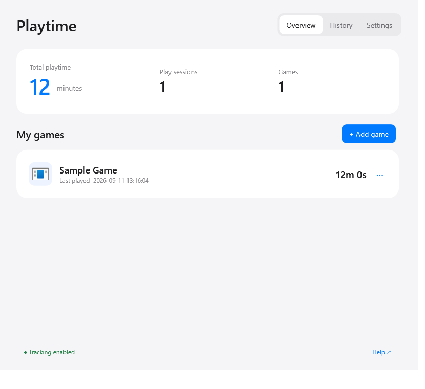

# Playtime · 时长统计

<p align="center">
  <strong>A lightweight, local Windows playtime tracker for non-Steam games.</strong><br>
  简洁的 Windows 本地游戏时长统计器。添加一次，之后照常启动游戏即可。
</p>

<p align="center">
  <a href="https://github.com/spear607/playtime-windows/releases/latest"></a>
  
  <a href="LICENSE"></a>
  
</p>

<p align="center">
  <a href="https://github.com/spear607/playtime-windows/releases/latest"><strong>Download the latest Windows release</strong></a>
  ·
  <a href="https://github.com/spear607/playtime-windows/issues">Report a problem</a>
</p>

<p align="center">
  
</p>

Playtime automatically records how long selected Windows games are running. It is designed for people who want Steam-style playtime for local or non-Steam games without creating an account, managing a large game library, or sending activity to a cloud service.

时长统计会自动记录你添加的 Windows 游戏运行了多久。它适合希望统计本地游戏、非 Steam 游戏时长，同时又不需要账号、云同步和复杂游戏库管理的人。

## Why Playtime?

- **Launch normally** — you do not need to use a special tracking shortcut.
- **Easy game setup** — choose a desktop shortcut, an EXE, or a visible running game window.
- **Automatic tracking** — records total time, play count, and individual sessions in the background.
- **Local and private** — no account, telemetry, advertising, or network requests.
- **Portable data** — readable JSON files, backup import/export, and no database server.
- **Small scope** — no achievements, social feed, cover-art library, or complex charts.
- **Four languages** — Simplified Chinese, Traditional Chinese, English, and Japanese.

## Quick start

1. Open the [latest release](https://github.com/spear607/playtime-windows/releases/latest) and download `Playtime-*-windows-x64.zip`.
2. Extract the ZIP into a writable folder. Do not run it from inside the ZIP.
3. Run `Playtime.exe`.
4. Select **Add game**, then choose a desktop shortcut, an EXE, or a running game window.
5. Launch the game normally. Closing the Playtime window keeps tracking active in the system tray.

Windows 10/11 x64 with .NET Framework 4.8 or later is supported. The portable executable is currently unsigned; each release includes a SHA-256 checksum.

### 添加游戏

1. 在 [Releases](https://github.com/spear607/playtime-windows/releases/latest) 下载 Windows x64 压缩包并解压。
2. 运行 `Playtime.exe`，点击“添加游戏”。
3. 可以从个人与公共桌面图标中选择，也可以选择 EXE，或从当前可见的游戏窗口中选择。
4. 保存后照常启动游戏。关闭主窗口后，程序会留在系统托盘继续统计。

## What is recorded?

- Total playtime and play count for each configured game
- Start time, end time, duration, and status for every session
- Manual corrections, removable sessions, and interrupted-session recovery
- Optional startup when signing in to Windows, disabled by default

All configuration and history stays beside the application in the `data` folder:

```text
data/
├── settings.json
├── sessions/
├── active/
└── trash/
```

Back up the `data` folder or use the built-in JSON export. Release packages never include local user data.

## Accuracy and limitations

Playtime measures **process runtime**, including time spent idle or in the background. It does not measure keyboard, controller, or foreground-window activity.

The tracker listens for process changes when Windows permits it and performs lightweight checks while a session is active. Detection can be a few seconds late at either boundary. Very short games, unusual multi-stage launchers, protected processes, sleep transitions, and inaccessible executable paths can affect results. Advanced settings let you specify the real game process and its installation directory.

Administrator access is not normally required. Some protected or anti-cheat games may expose less process information to a standard user.

## Update or remove

To update, quit Playtime from the tray, keep the existing `data` folder, and replace the other application files with the new release.

To remove it, disable “Start when I sign in to Windows,” quit the tray application, and delete its folder. Playtime does not install a service or scheduled task.

## Build and verify

```powershell
.\build.ps1
.\tests\test.ps1
.\build.ps1 -Package
```

The project uses the Windows .NET Framework C# compiler and WPF assemblies. It has no NuGet dependencies or third-party runtime. GitHub Actions builds and tests the project on Windows. Source code remains compatible with C# 5.

## Project status

Version 0.1.1 is an early preview. It has automated checks for tracking state transitions, crash recovery, backup behavior, localization completeness, and the main UI flows. More real-world testing is still needed for launchers, anti-cheat games, hardware sleep, and different Windows configurations.

Focused bug reports and translation corrections are welcome through [GitHub Issues](https://github.com/spear607/playtime-windows/issues).

## License

[MIT](LICENSE) © 2026 Playtime contributors
